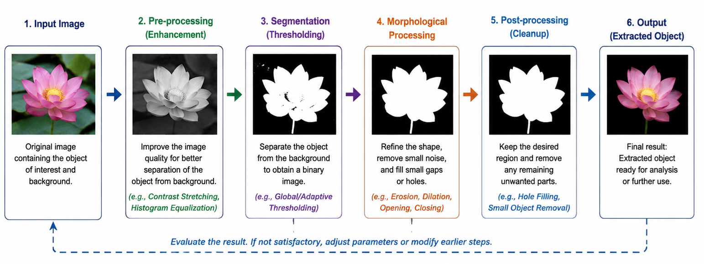
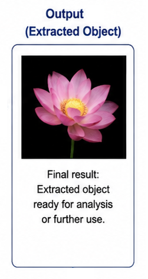

Image processing problems often cannot be solved effectively using a single operation. A practical image processing task may require several operations to be performed in a particular sequence. For example, an image may first need to be enhanced, followed by segmentation to isolate the required region. The result of one operation then becomes the input to the next operation.

This experiment provides a modular environment in which different image processing operations can be combined as a sequence of processing steps. The purpose of this experiment is to understand how individual image processing techniques can work together to solve a given image processing problem.

In this experiment, an image processing problem is treated as a sequence of smaller processing tasks. Each task applies a particular operation to the image and produces an intermediate result. These intermediate results can then be passed to subsequent operations until the required output is obtained.

The important idea is that an image processing solution is not always a single operation. Instead, an appropriate sequence of operations can be designed according to the characteristics of the input image and the desired output.

### Image Processing Modules

A **module** is an individual image processing operation that performs a specific task on an image. A module receives an input image, processes it according to its operation, and produces an output image.

Different modules can perform different types of processing. Depending on the image processing problem, a solution may use operations such as point operations, histogram operations, filtering, segmentation, or morphological operations.

For example, an image may first be processed using a point operation to modify its pixel values, followed by segmentation to separate a required region from the background. Morphological operations may then be used to refine the segmented region.

The output of one module can therefore become the input of another module.

A sequence of modules can be represented as

$$
I_0
\rightarrow
I_1
\rightarrow
I_2
\rightarrow
\cdots
\rightarrow
I_n
$$

where $I_0$ is the original input image and $I_1,I_2,\ldots,I_n$ are the intermediate and final results produced by successive processing modules.

If the processing operations are represented by $T_1,T_2,\ldots,T_n$, the complete processing sequence can be expressed as

$$
I_n =
T_n
\left(
T_{n-1}
\left(
\cdots
T_2
\left(
T_1(I_0)
\right)
\cdots
\right)
\right)
$$

This representation shows that the final result depends not only on the individual operations but also on the **sequence in which they are applied**.

### Processing Pipeline

A sequence of image processing modules is commonly called a **processing pipeline**. In a pipeline, the output produced by one module is passed to the next module as its input.

A general image processing pipeline can be represented as

$$
\text{Input Image}
\rightarrow
\text{Processing Module 1}
\rightarrow
\text{Processing Module 2}
\rightarrow
\text{Processing Module 3}
\rightarrow
\text{Output}
$$

For example, consider an image in which the required object is difficult to distinguish because of uneven brightness. A point operation can first be used to modify the pixel values and improve the separation between the object and its surroundings. The resulting image can then be given to a segmentation operation to isolate the required region. Morphological processing may subsequently be used to remove small unwanted regions or fill small gaps.

Thus, a possible processing sequence is

$$
\text{Input Image}
\rightarrow
\text{Point Operation}
\rightarrow
\text{Segmentation}
\rightarrow
\text{Morphological Processing}
\rightarrow
\text{Extracted Region}
$$

The following figure illustrates the general idea of constructing an image processing solution by connecting different processing modules.

_Figure 1: A modular image processing pipeline showing how successive processing modules can be combined to obtain an extracted object._

The figure shows a sequence beginning with an input image and progressing through pre-processing, segmentation, morphological processing, and post-processing before producing the extracted object. The output of each stage becomes the input to the next stage.

The figure also illustrates an important characteristic of a practical processing pipeline: the result can be evaluated and earlier processing steps can be modified if the final output is not satisfactory.

The figure is a conceptual example of a processing pipeline. It does not represent one fixed sequence that must be used for every problem in the Image Processing Test Bench. The appropriate modules and their order depend on the particular image processing problem.

### Designing an Image Processing Solution

Before constructing a processing pipeline, the image processing problem should be analysed carefully.

The first step is to identify **what needs to be extracted, enhanced, detected, or modified** in the input image. The characteristics of the required information and the surrounding background should then be examined.

The problem can then be divided into smaller processing steps. Each step should have a clear purpose.

A general approach is:

1. **Identify the required result.**

   Determine what region, object, feature, or information needs to be obtained from the image.

2. **Examine the input image.**

   Observe characteristics such as brightness, contrast, intensity differences, boundaries, texture, and unwanted information.

3. **Identify the difficulty in the image.**

   Determine why the required information cannot already be separated or extracted directly.

4. **Select an appropriate processing operation.**

   Choose a module that addresses the particular difficulty in the image.

5. **Connect the processing steps.**

   Use the output of one operation as the input to the next operation.

6. **Examine intermediate results.**

   Determine whether each processing step is producing the expected effect.

7. **Evaluate the final result.**

   Check whether the required region or information has been successfully obtained.

This step-by-step approach makes it easier to understand how individual image processing techniques contribute to solving a complete problem.

### Importance of Intermediate Results

An important feature of a modular processing approach is that the intermediate results can be examined after each processing step.

For example, suppose an input image contains a required object whose intensity is not sufficiently distinct from the background. Applying segmentation directly may not produce a satisfactory result.

A preceding point operation may first modify the pixel values so that the object becomes easier to distinguish. The segmentation operation can then work on this modified image.

The processing can therefore be viewed as

$$
I_0
\xrightarrow{T_1}
I_1
\xrightarrow{T_2}
I_2
$$

where $I_0$ is the original image, $T_1$ is the first processing operation, $I_1$ is the intermediate result, $T_2$ is the next operation, and $I_2$ is the resulting image.

The intermediate image $I_1$ is important because it allows the effect of $T_1$ to be evaluated before the next operation is applied.

This makes it easier to determine **which processing step is responsible for an improvement or an unwanted change in the result**.

If an intermediate result is unsatisfactory, it may be more effective to modify the corresponding processing step rather than continuing with additional operations.

### Order of Processing Operations

The order in which modules are applied can affect the final result.

Consider two processing operations $T_1$ and $T_2$. Applying them in one order gives

$$
I_2 =
T_2
\left(
T_1(I_0)
\right)
$$

whereas reversing their order gives

$$
I'_2 =
T_1
\left(
T_2(I_0)
\right)
$$

In general,

$$
T_2
\left(
T_1(I_0)
\right)
\neq
T_1
\left(
T_2(I_0)
\right)
$$

Therefore, simply selecting appropriate operations is not sufficient. The operations must also be arranged in a suitable sequence.

For example, if an image needs brightness normalization before segmentation, performing segmentation first may produce a poorer result than normalizing the image before segmentation.

For this reason, this experiment encourages a **step-by-step approach** in which the effect of each module can be observed before deciding how to proceed.

### Combining Image Processing Techniques

The Test Bench is particularly useful for understanding how concepts studied in different image processing experiments can be combined.

For example, **point operations** modify pixel values independently at each pixel location. They can be useful when the intensity characteristics of an image need to be adjusted.

**Segmentation** can then be used when the objective is to separate a required region from the rest of the image.

**Morphological operations** can subsequently be used to refine the segmented region by modifying its shape or removing small unwanted structures.

Thus, a problem may require concepts from more than one image processing technique.

A simple example is the extraction of leaf regions from an image. If the leaf brightness is not sufficiently suitable for segmentation, a point operation can first be used to normalize the brightness. Segmentation can then be applied to isolate the leaves.

This can be represented as

$$
\text{Original Image}
\rightarrow
\text{Brightness Normalization}
\rightarrow
\text{Segmentation}
\rightarrow
\text{Leaf Region}
$$

The important point is that the individual operations are not being studied in isolation. Their combination is used to construct a solution to a specific image processing problem.

### Problem Decomposition

A complex image processing problem can often be simplified by dividing it into smaller tasks.

For example, the general task

> **Extract a particular object from an image**

can be divided into smaller questions:

- How can the relevant image information be made more distinguishable?
- Which image characteristics separate the required object from the background?
- Which processing operation can enhance this difference?
- Which operation can isolate the required region?
- Is the resulting region sufficiently close to the desired output?
- If not, which earlier processing step should be modified?

The following figure provides a visual example of the final stage of such a process, where the required object has been separated from the surrounding image.

_Figure 2: Example of an extracted object obtained after applying a sequence of image processing operations._

The figure illustrates the desired outcome of an object-extraction problem: the required object is retained while the surrounding background is removed or suppressed.

The figure should be understood as the **output of a processing pipeline**, rather than as the result of a single operation. In an actual problem, several processing modules may be required before such an output can be obtained.

This process of dividing a complex image processing problem into smaller tasks is called **problem decomposition**. It allows a complex problem to be approached as a sequence of simpler operations.

Here, this approach helps in developing a processing pipeline rather than attempting to solve the complete problem using a single operation.

### Evaluating a Processing Pipeline

A processing pipeline should not be considered successful merely because every selected module produces an output.

The final result should be evaluated against the original objective.

For an extraction problem, useful observations include:

- whether the required region has been successfully isolated;
- whether unwanted background regions have also been selected;
- whether important parts of the required object have been lost;
- whether the result contains unnecessary noise or other regions; and
- whether changing an earlier processing step improves the final result.

The intermediate results should also be examined. If the final output is unsatisfactory, the processing sequence can be reconsidered and individual modules or their parameters can be modified.

This makes the Test Bench a useful environment for understanding the relationship between **processing choices, intermediate results, and final output quality**.

The pipeline figure also represents this idea through the evaluation and feedback stage: the processing sequence need not always be treated as a one-way process. An unsatisfactory output can provide information about which earlier stage needs to be reconsidered.

### Application to Image Processing Problems

The assessment tasks in this experiment illustrate different types of image processing problems. The tasks include extracting bushes, leaves, non-English text, tiger whiskers, and the Taj Mahal from given images.

The characteristics that distinguish the required region may be different in each case. Therefore, the same processing sequence may not be appropriate for every image.

A successful solution depends on analysing the particular image, identifying the characteristics that can be used to separate the required information, and selecting and arranging suitable processing modules.

For the leaf extraction task, for example, the assessment provides a specific hint to use point operations to normalize the leaf brightness before applying segmentation. This demonstrates how one processing technique can prepare an image for another technique.

Similarly, an object with small unwanted regions after segmentation may require morphological processing before the final result is obtained.

The Test Bench therefore provides an opportunity to apply concepts learned in earlier experiments in an integrated manner.

### A Modular Approach to Image Processing

The modular approach has an important advantage: a complete image processing solution can be built from smaller, understandable operations.

Instead of treating the solution as one complicated process, each module can be studied separately:

$$
\text{Input}
\rightarrow
T_1
\rightarrow
T_2
\rightarrow
T_3
\rightarrow
\text{Output}
$$

Each module has a specific purpose, while the complete sequence addresses the overall image processing problem.

If the result is not satisfactory, the sequence can be analysed to determine which stage may need modification. This makes the development and evaluation of an image processing solution more systematic.

The modular approach also makes it possible to reuse familiar image processing techniques in different combinations for different problems.

### What to Observe in the Image Processing Test Bench

In this experiment, pay particular attention to the relationship between the individual processing modules and the final result.

Observe:

- how an image processing problem can be divided into smaller processing steps;
- how the output of one module becomes the input to the next module;
- how intermediate results change as successive operations are applied;
- how the order of processing operations can affect the final result;
- how point operations can modify image characteristics before another operation is applied;
- how segmentation can be used to isolate required image regions;
- how morphological operations can refine the result of segmentation;
- how different image processing problems may require different processing sequences;
- how an unsatisfactory intermediate result can affect all subsequent processing steps;
- how changing an earlier processing step can change the final output; and
- how a sequence of relatively simple operations can be combined to solve a more complex image processing problem.

These observations help connect the individual concepts studied in the earlier experiments with their application in a complete image processing workflow.

### Understanding the Image Processing Test Bench

The central idea of the **Image Processing Test Bench experiment** is that solving an image processing problem often requires more than one operation.

A processing module performs a specific task on an image, while a processing pipeline combines several modules in a meaningful sequence. The output of one module becomes the input to the next, and the intermediate results provide useful information for evaluating the processing sequence.

The complete process can be represented as

$$
I_0
\xrightarrow{T_1}
I_1
\xrightarrow{T_2}
I_2
\xrightarrow{T_3}
\cdots
\xrightarrow{T_n}
I_n
$$

where $I_0$ is the original image, $T_1,T_2,\ldots,T_n$ are the selected image processing operations, and $I_n$ is the final result.

The key learning outcome of the **Image Processing Test Bench experiment** is therefore not to find one universally applicable operation, but to understand how an image processing problem can be **analysed, decomposed into appropriate processing steps, implemented as a sequence of modules, and evaluated using the intermediate and final results**.

This modular, step-by-step approach provides a practical way to combine image processing concepts and techniques to develop solutions for different image processing problems.
